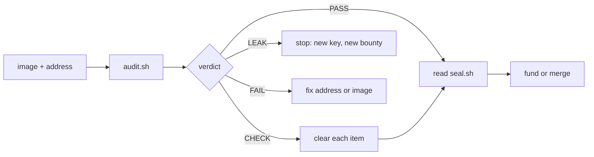

# Audit a target

**One line.** Take the image apart layer by layer and look for the one thing that must not be there: the bounty key.



## Rules

| # | Rule | Why |
|---|---|---|
| 1 | The scan never runs the image: `docker save`, then a clean Python container reads the archive. | A target is untrusted code. |
| 2 | Report locations, never key material. | A found bounty key is money; logs are public. |
| 3 | A LEAK retires the key: never fund it; if funded, the vendor moves the coins out. | Anyone may already hold a copy. |
| 4 | PASS does not prove the record holds the key. | Nobody can open it, by design. The evidence is `seal.sh` and the vendor's control. |

## Run

`S` = the folder of this `SKILL.md`, e.g. `.github/skills/audit-target`. `IMAGE` = a local tag or `registry/name@sha256:…`; `ADDRESS` = the bounty address.

```bash
"$S"/scripts/audit.sh "$IMAGE" "$ADDRESS"
```

From a manifest:

```bash
"$S"/scripts/audit.sh "$(jq -r .image hello-age.json)" "$(jq -r .address hello-age.json)"
```

| Exit | Verdict | Meaning | Next |
|---|---|---|---|
| 0 | PASS | No bounty key; the address matches | Read `seal.sh` |
| 1 | LEAK | The bounty key sits in the image | Stop. Seal again with a new key |
| 2 | FAIL | Address missing or different, or a layer unreadable | Fix, run again |
| 3 | CHECK | No bounty key; other key material listed | Clear each item, then read `seal.sh` |
| 64, 70 | | Usage; `pip install bit` failed | |

[audit.sh](./scripts/audit.sh) pulls the image if it is not local. [scan.py](./scripts/scan.py) does the reading.

## What it covers

| Looks at | For |
|---|---|
| Every layer in order, files deleted later included | The bounty key as WIF or 64 hex digits: derives both address types (`1…`, `3…`) |
| Config: env, labels, build history with `ARG` values | Same |
| Every other blob in the archive | Same |
| `/bounty/address` in the final image | Equal to `ADDRESS` |
| All of the above | Age secret keys, PEM private keys, BIP32 `xprv`: listed for a hand check |

Not covered: an opening secret with no fixed shape (a restic password, a SQLCipher raw key). The defense is `seal.sh`: read it.

## Clear a CHECK

Fixtures in every template image (python:3.13-alpine, bit 0.8.0, age 1.3.2):

| Line | Path | Source |
|---|---|---|
| `wif` other keys | `usr/local/lib/python3.13/site-packages/tests/samples.py` | bit test suite |
| `PEM private key` | `usr/local/lib/python3.13/site-packages/tests/__pycache__/samples.cpython-313.pyc` | bit test suite |
| `age secret key` | `usr/bin/age-keygen` | Example in the help text; age images only |

An item clears when it cannot open the record:

- restic and SQLCipher records open only with their password or raw key: no listed item can.
- An age record opens only with an age secret key. Try each one, network off:

```bash
docker run --rm --network none "$IMAGE" sh -c '
  grep -aoE "AGE-SECRET-KEY-(PQ-)?1[0-9A-Z]{58}" /usr/bin/age-keygen | while read -r k; do
    echo "$k" > /tmp/id; age -d -i /tmp/id /bounty/bounty.age >/dev/null 2>&1 && echo OPENS
  done; echo checked'
```

**expect:** `checked` alone. For another path, replace `/usr/bin/age-keygen`. This step runs the image, network off.

## Read seal.sh

The audit prints the final `/bounty/seal.sh`. It passes when:

- It is a recipe from seal-target: only the product block differs.
- The bounty key moves through pipes and shell variables only; nothing is echoed to the log.
- The opening secret is random and never written.

The whole build, step by step: `docker history --no-trunc --format '{{.CreatedBy}}' "$IMAGE"`.
