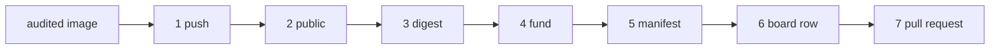

# List a target

**One line.** Make the audited image public, fund its address, and add a three-field manifest to the board.



## Rules

| # | Rule | Why |
|---|---|---|
| 1 | List only an image that passed audit-target, by digest. | The evidence belongs to exact bits. |
| 2 | Push, visibility, funding and the pull request are human steps: the agent prepares the command and waits for a go. | They are public or move money. |
| 3 | One target, one key, one address. A new image is a new target with a new name. | Board rule. |
| 4 | The manifest holds three fields. The image and the blockchain prove the rest. | Less to trust, less to review. |

## Steps

`NAME` = the local image tag from seal-target. `OWNER` = the ghcr.io namespace. `BOARD` = a local clone of your fork of the board repository.

```bash
NAME=hello-age OWNER=your-github-user BOARD=~/code/proof-of-security-board
ADDRESS=$(docker run --rm "$NAME" cat /bounty/address)
```

**1. Push** (human go). Needs `docker login ghcr.io` with a token that has `write:packages`.

```bash
docker tag "$NAME" "ghcr.io/$OWNER/$NAME" && docker push "ghcr.io/$OWNER/$NAME"
```

**2. Make it public** (human): GitHub > Packages > `NAME` > Package settings > Change visibility > Public.

**3. Digest, read without credentials.**

```bash
IMAGE="ghcr.io/$OWNER/$NAME@$(DOCKER_CONFIG=$(mktemp -d) docker buildx imagetools inspect "ghcr.io/$OWNER/$NAME" --format '{{.Manifest.Digest}}')"
echo "$IMAGE"
```

**expect:** `ghcr.io/OWNER/NAME@sha256:` and 64 hex digits.

- **if `failed to fetch anonymous token`:** the package is still private.

**4. Fund** (human): send the bounty to `$ADDRESS` from any wallet. Then:

```bash
curl -sf "https://mempool.space/api/address/$ADDRESS" | jq '.chain_stats.funded_txo_sum, .mempool_stats.funded_txo_sum'
```

**expect:** the first number above 0: satoshis with at least one confirmation.

- **if only the second:** the transaction waits for a block.

**5. Manifest.**

```bash
cat > "$NAME.json" <<EOF
{
  "image": "$IMAGE",
  "address": "$ADDRESS",
  "listed": "$(date -u +%F)"
}
EOF
```

Optional field: `source`, a link to the code.

**6. Board row.**

```bash
cp "$NAME.json" "$BOARD/targets/" && (cd "$BOARD" && bash board.sh | grep -F "| $NAME |")
```

**expect:** one row: `| NAME | <BTC> | standing since <today> | … |`.

- **if no row:** a field fails the board's checks: name in lowercase letters, digits and hyphens; address of 26 to 62 letters and digits; date `YYYY-MM-DD`.

**7. Pull request** (human go).

```bash
cd "$BOARD" && git switch -c "list-$NAME" && git add "targets/$NAME.json" && git commit -m "list $NAME" && git push -u origin "list-$NAME"
```

Open the pull request from the link that `git push` prints.

## Gotchas

| Symptom | Cause | Fix |
|---|---|---|
| `denied` on push | The token lacks `write:packages`, or `OWNER` is not your namespace | New token, right `OWNER` |
| Board shows `unfunded` after funding | No confirmation yet | Wait for a block |
| `RepoDigests` is empty | Read before the push | Step 3 reads the registry |
