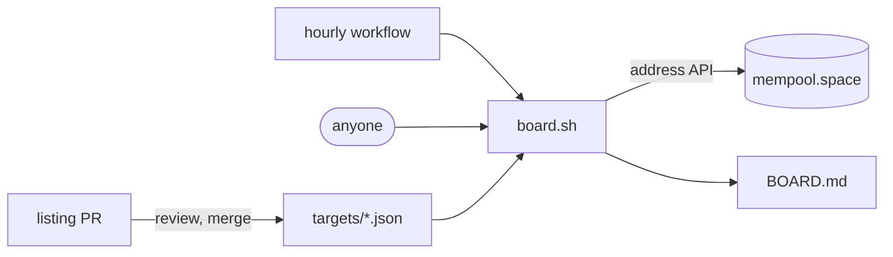

# Run a board

**One line.** A board is a public repository: manifests in `targets/`, one script that reads the blockchain, one workflow that commits the table.



## Rules

| # | Rule | Why |
|---|---|---|
| 1 | The workflow runs on schedule and by hand only, from the default branch; never on `pull_request_target`. | Listings come from strangers; the workflow holds a write token. |
| 2 | Actions pinned by commit SHA. | A moved tag would run new code with that token. |
| 3 | Merge a listing only after the review below. | One bad address fails every run. |
| 4 | Anyone can recompute the board with `bash board.sh`. | The board asks for no trust. |

## Create

`S` = the folder of this `SKILL.md`, e.g. `.github/skills/run-board`. A human creates an empty public repository and clones it; `BOARD` = the clone.

```bash
BOARD=~/code/proof-of-security-board
mkdir -p "$BOARD/targets" "$BOARD/.github/workflows"
cp "$S/scripts/board.sh" "$BOARD/" && cp "$S/assets/board.yml" "$BOARD/.github/workflows/"
touch "$BOARD/targets/.gitkeep"
cd "$BOARD" && bash board.sh
```

**expect:** the table header, then `Checked <today> UTC.`

Commit and push (human go). First run: Actions > board > Run workflow.

**expect:** a `board` commit that adds `BOARD.md`.

| File | Job |
|---|---|
| [board.sh](./scripts/board.sh) | One API call per manifest; only checked values reach the URL and the table |
| [board.yml](./assets/board.yml) | Hourly at minute 17; commits `BOARD.md` when it changes |

## Review a listing

`PR` = the pull request number, `F` = the manifest it adds. `board.sh` comes from the default branch, never from the pull request.

```bash
PR=12 F=targets/hello-age.json
git fetch -q origin && git remote set-head origin -a > /dev/null
git fetch origin "pull/$PR/head:pr-$PR" && git switch "pr-$PR"
git diff --name-status origin/HEAD...HEAD
jq -e '(.image | test("@sha256:[0-9a-f]{64}$")) and (.address | test("^[a-zA-Z0-9]{26,62}$")) and (.listed | test("^[0-9]{4}-[0-9]{2}-[0-9]{2}$"))' "$F"
DOCKER_CONFIG=$(mktemp -d) docker buildx imagetools inspect "$(jq -r .image "$F")" --format '{{println .Manifest.Digest}}'
curl -sf "https://mempool.space/api/address/$(jq -r .address "$F")" | jq -c .chain_stats
grep -lF "$(jq -r .address "$F")" targets/*.json
bash <(git show origin/HEAD:board.sh) | grep -F "| $(basename "$F" .json) |"
```

| # | Check | Pass |
|---|---|---|
| 1 | Changed files | Exactly `A targets/<name>.json`, name in lowercase letters, digits and hyphens, not taken |
| 2 | Fields | `true` |
| 3 | Public image | The digest, read without credentials |
| 4 | Address | `funded_txo_sum` above 0, `spent_txo_sum` 0; found in `$F` only |
| 5 | Row | One row |
| 6 | Image | audit-target on the manifest: PASS, or CHECK with every item cleared |

Set `listed` to the merge date if it differs, then merge (human).

## Gotchas

| Symptom | Cause | Fix |
|---|---|---|
| Run fails, `BOARD.md` stale | The API rejects one address, or is down | Fix or remove the manifest; run again. The `Checked` date shows the age |
| Schedule stopped | GitHub disables schedules after 60 days without repository activity | Re-enable in the Actions tab |
| Push rejected | Protected default branch | Allow the workflow to push |
| New target shows `unfunded` | No confirmation yet | Wait for a block |
