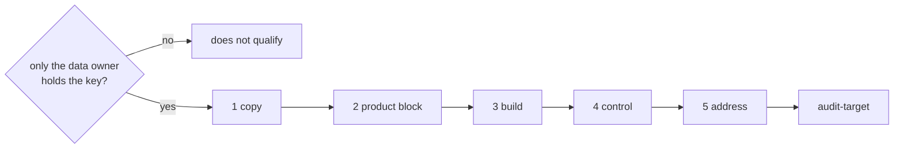

# Seal a target

**One line.** The build makes the bounty key, seals it with the product under a secret nobody keeps, and ships product, record and sealing software as one image.



## Rules

| # | Rule | Why |
|---|---|---|
| 1 | The bounty key exists only inside the seal pipe: never `ARG`, `ENV`, a file, a tool argument or a log line. | Every layer, the config and the build history ship to strangers. |
| 2 | The opening secret is random (256 bits), made inside the seal and never written. | A secret in the image hands out the bounty. |
| 3 | The seal prints nothing. | Build logs and build records are often public. |
| 4 | Release builds use `--no-cache` and a base image pinned by digest. | A cached build reuses an old seal; a tag moves. |
| 5 | Humans fund and publish. The agent never sees, asks for or moves a key. | The key is money. |
| 6 | One tool, one record: no service, no daemon. | The challenger attacks a file, not a server. |

## Qualify the product

| Design | Qualifies |
|---|---|
| Access control in front of plaintext on disk | No: the disk ships |
| Encryption at rest, key held by the server | No: the key ships too |
| Encryption with a key only the data owner holds | Yes |

Prefer an Alpine package or one static binary. Tested recipes and the checklist for a new product: [recipes.md](./references/recipes.md).

## Steps

`S` = the folder of this `SKILL.md`, e.g. `.github/skills/seal-target`. `NAME` = the target name: lowercase letters, digits, hyphens.

**1. Copy the template** (the age target).

```bash
NAME=hello-age
mkdir "$NAME" && cp "$S"/assets/* "$NAME"/ && cd "$NAME"
```

| File | Job |
|---|---|
| [seal.sh](./assets/seal.sh) | Runs once in the build: makes the key, writes `address`, seals the record |
| [Dockerfile](./assets/Dockerfile) | Product and `bit`, then the seal; `CMD` writes the record to stdout |
| [control.sh](./assets/control.sh) | The same seal with the secret kept, then the record opened; never shipped |

**2. Swap the product block.** age: skip. Otherwise apply the recipe to all three files.

**3. Build.**

```bash
DIGEST=$(DOCKER_CONFIG=$(mktemp -d) docker buildx imagetools inspect python:3.13-alpine --format '{{.Manifest.Digest}}')
sed -i "s|^FROM python:3.13-alpine\$|FROM python:3.13-alpine@$DIGEST|" Dockerfile
LOG=$(mktemp)
docker build --no-cache --progress=plain -t "$NAME" . > "$LOG" 2>&1 || tail -n 20 "$LOG"
awk '/RUN sh \/bounty\/seal.sh$/ {id = $1} id && $1 == id && $2 ~ /^[0-9.]+$/ {n++} END {print n + 0}' "$LOG"; rm "$LOG"
```

**expect:** `0`: the seal printed no line.

- **if more:** do not read the lines and do not fund. Find the printing command with the control, fix it, build again: a new key.
- **if the build failed:** the tail shows why. That key was never funded.

**4. Control round trip.**

```bash
docker run --rm --network none -v "$PWD/control.sh:/control.sh:ro" "$NAME" sh /control.sh
```

**expect:** `round trip ok`: the shipped tool seals and opens a key this way.

- **if not:** fix the block. A record that does not hold the key can never be claimed.

**5. Address.**

```bash
docker run --rm "$NAME" cat /bounty/address
```

**expect:** an address that starts with `1`.

Next: audit-target with `$NAME` and this address. Then list-target: a human publishes and funds.

## Gotchas

| Symptom | Cause | Fix |
|---|---|---|
| Same address after a rebuild, or in two targets | The seal layer came from the cache, even one built in another folder | `--no-cache` |
| `RepoDigests` is empty | A digest exists only after a push or pull | list-target reads it from the registry |
| Control passes, build prints lines | A command in the block writes to stdout or stderr | Redirect it to `/dev/null`, as the SQLCipher recipe does |
