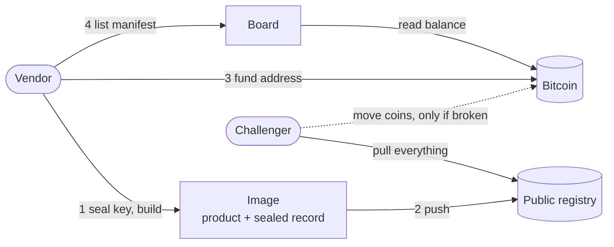
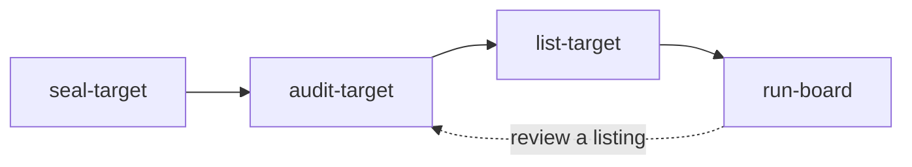

# Proof of security

*Break it, keep the bitcoin.*

**TL;DR** A vendor seals the private key of a funded Bitcoin address with its own product and publishes all of it: product, sealed record, sealing software. Whoever opens the record keeps the coins; the untouched balance is public proof that nobody has.

| Go to | For |
|---|---|
| [The board](BOARD.md) | Every target, its bounty and whether it still stands |
| [Hello world](EXAMPLE.md) | A target built from two files, from seal to claim |
| [List your product](#list-your-product) | One pull request puts your product on the board |

## Why

Most software is safe until someone gets in. **Bitcoin is safe with everyone in.**

| | Most software today | Trustless by design |
|---|---|---|
| The key | On the server, next to the data | Only with its owner |
| The defense | A guarded door: passwords, second factors, firewalls | No door: public-key cryptography, multisig |
| A break-in | Takes everything | Opens nothing |

The second column is easy to promise and hard to prove. A bounty changes that: ship everything, with the key to real coins sealed inside.

Proof of security is one tool of the [Immune software manifesto](README.md): five principles for software that is safe with everyone in. It tests the second: keys, not walls.

## The idea

| Term | Meaning |
|---|---|
| Bounty | A Bitcoin private key, sealed as one record by the product under test |
| Target | One public container image: the product, the sealed record and the software that sealed it |
| Manifest | A JSON file that names the image and the bounty address |
| Board | A public git repository of manifests, plus a script that reads every bounty address from the blockchain |



- There is no claim form and no judge: the key is the payout.
- The board asks for no trust: anyone can recompute it from the manifests and the blockchain.
- Source code is a plus, not a must. A closed product ships the same way, as an image.

## Everything ships

Bitcoin is the model: the whole ledger sits on every disk, and no coin moves without a key that is not there.

- The challenger gets what an insider gets: binary, data, configuration.
- No hosting, no endpoint, no permission: challengers attack their own copy.
- So the secret cannot live in the box: the build creates a random one, seals the bounty with it and drops it.

| Design | Qualifies |
|---|---|
| Access control in front of plaintext on disk | No: the disk ships |
| Encryption at rest, key held by the server | No: the key ships too |
| Encryption with a key only the data owner holds | Yes |

## The board

[BOARD.md](BOARD.md) lists every target with its bounty and status. Nobody edits it: a [workflow](.github/workflows/board.yml) rebuilds it each hour from the manifests in [targets/](targets) and the blockchain.

- To attack a target, take its manifest: [one command](EXAMPLE.md#challenger-one-command) pulls everything.
- To check the board, recompute it from a clone with `jq` and `curl`:

```bash
bash board.sh
```

| Rule | Reason |
|---|---|
| One target is one image digest. A new version is a new target with its own bounty. | The evidence belongs to exact bits |
| Coins moved means claimed, whoever moved them and however they got in. | The vendor cannot withdraw quietly |

## What it proves

- Exactly this: nobody turned this image into X BTC since date D. You judge X and D.
- It covers the product as shipped: its design, this exact build, every file it wrote and the software that sealed the record. It does not cover how you guard your own keys.

| Gap | Next rung |
|---|---|
| You take the vendor's word that the record holds the key, and the vendor has no honest exit | Keep the secret offline instead of dropping it. To retire, move the coins and publish it: anyone opens the record and checks |
| Only secrecy is tested, not forgery | Open: a forged record steals no key, so something must judge it |
| The winner does not have to explain the break | Accepted: `claimed` is the signal to stop trusting that image |

## List your product

You seal and fund your own bounty; the board only shows it. The listing is one pull request to this repository that adds your manifest to [targets/](targets).

| Question | Answer |
|---|---|
| Does my product qualify? | Yes, when only the data owner holds the key: see [Everything ships](#everything-ships). Good fits: file encryption, encrypted databases, backup tools, password vaults, secrets stores |
| How do I build a target? | By hand: the four vendor steps in the [hello world](EXAMPLE.md#vendor-four-steps). With an agent: the skills below |
| Is there a recipe? | age, restic and SQLCipher are tested. A new product changes a few lines: [recipes](.github/skills/seal-target/references/recipes.md) |
| What does the board check before merge? | One manifest, a public image pinned by digest, a funded and unspent address, an audit |

## Skills to assemble challenges

Agent skills in `.github/skills/`, found automatically in this workspace. Agents prepare and check; humans fund, publish and merge.



| Skill | Job |
|---|---|
| [seal-target](.github/skills/seal-target/SKILL.md) | Build a target from a recipe: silent seal, control round trip, address |
| [audit-target](.github/skills/audit-target/SKILL.md) | Scan layers, config and build history for the bounty key without running the image |
| [list-target](.github/skills/list-target/SKILL.md) | Publish, check anonymous pull and funding, write the manifest, prepare the pull request |
| [run-board](.github/skills/run-board/SKILL.md) | Review listing pull requests; create a board in another repository |

In other workspaces, link them as personal skills. Run from the root of this repository:

```bash
ls -d .github/skills/*/ && mkdir -p ~/.copilot/skills && for s in .github/skills/*/; do ln -sfn "$PWD/${s%/}" ~/.copilot/skills/"$(basename "$s")"; done
```

## Compared with a bug bounty program

| | Bug bounty program | Proof of security |
|---|---|---|
| What the attacker gets | An endpoint | Everything an insider has |
| Who pays out | The vendor, after triage | Nobody |
| Rules | A legal scope document | None needed: nothing live is attacked |
| Public evidence | What the vendor chooses to disclose | An address anyone can check |
| The claim | "We run a bounty program" | "1 BTC, unclaimed since 2026-11-25" |

**Precedent.** In 2013 Peter Todd set up a [Bitcoin bounty](https://bitcointalk.org/index.php?topic=293382.0) that only a SHA-1 collision could unlock. It stood 1,259 days and [paid itself out](https://mempool.space/address/37k7toV1Nv4DfmQbmZ8KuZDQCYK9x5KpzP) on 2017-02-23, the day the first collision was published: 2.49 BTC. Gregory Maxwell in that thread: "How sure do you want to be? Insert coins."
